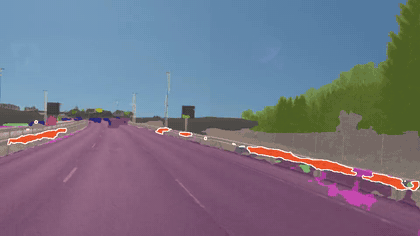
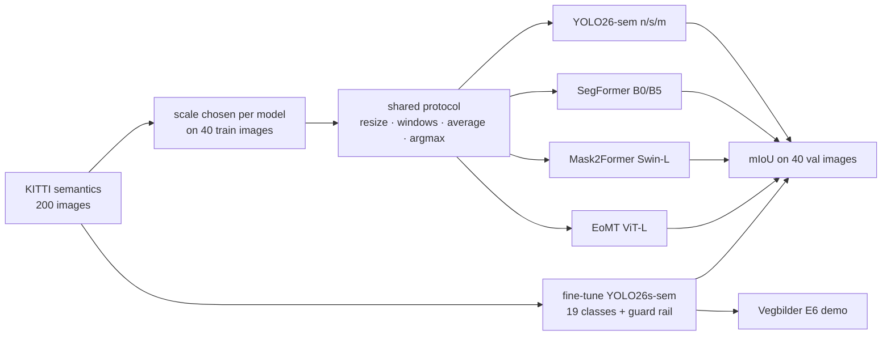
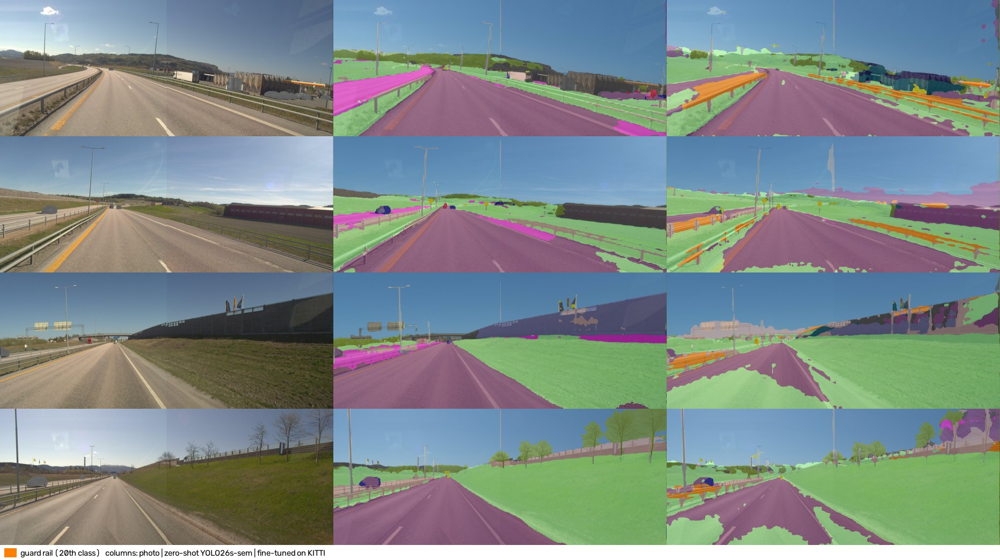

# Road scene segmentation

Pixel-wise classification of road scenes (road, sidewalk, vegetation, cars, poles, signs, …)
with four generations of models, from a 2021 transformer to a 2026 real-time YOLO, all run
under one inference protocol. Three questions:

1. **How well do Cityscapes models transfer?** Every model is trained on German and Swiss
   city streets (Cityscapes) and tested, without fine-tuning, on KITTI drives around Karlsruhe:
   another camera, another city, more rural roads.
2. **Do the published numbers hold?** A Slurm job reruns each checkpoint on Cityscapes val with
   this code, next to the number in its paper.
3. **Can a model learn what Cityscapes ignores?** Cityscapes annotates *guard rails* but leaves
   them out of its 19 evaluated classes, so no off-the-shelf model predicts them. KITTI keeps the
   annotation; a YOLO26 model fine-tuned on 160 KITTI images learns a 20th class, guard rail,
   and is tried on Statens vegvesen road photos from the E6 near Trondheim.

<p align="center"></p>



## Models

| Model | Year | Idea | Cityscapes val mIoU (published) |
|---|---|---|---|
| YOLO26n / s / m-sem | 2026 | real-time CNN, the newest Ultralytics family with a semantic head | 78.3 / 80.8 / 82.0 |
| SegFormer-B0 / B5 | 2021 | hierarchical transformer encoder, all-MLP decoder | 76.2 / 82.4 |
| Mask2Former Swin-L | 2022 | mask classification with masked-attention transformer decoder | 83.3 |
| EoMT-L | 2025 | a plain ViT (DINOv2) that predicts masks itself, no adapter or pixel decoder | 84.2 |

Published numbers, single-scale: Ultralytics documentation (YOLO26, 1024 × 2048), Xie et al.
Table 1 (SegFormer), Cheng et al. (Mask2Former), Kerssies et al. Table 5 (EoMT, which also
lists Mask2Former's 83.3). EoMT is the newest model with public Cityscapes weights. An EoMT
variant on DINOv3 exists in `transformers`, but only with COCO and ADE20K weights so far.

## Results

**Zero-shot: Cityscapes models on KITTI** (40 val images, IoU in %; the input height was
chosen per model on 40 training images; time per image on an Apple M4 Pro GPU):

| Model | Cityscapes val, paper | KITTI val mIoU | road | sidewalk | fence | pole | traffic sign | vegetation | car | height | ms/image |
|---|---|---|---|---|---|---|---|---|---|---|---|
| EoMT-L | 84.2 | **73.9** | 93.3 | 60.7 | 48.5 | 53.9 | 73.3 | 91.4 | 94.8 | 768 | 5667 |
| Mask2Former Swin-L | 83.3 | 65.0 | 93.8 | 64.6 | 43.2 | 51.7 | 84.0 | 91.4 | 94.1 | 768 | 2570 |
| SegFormer-B5 | 82.4 | 63.1 | 93.7 | 57.9 | 42.1 | 51.5 | 82.9 | 91.7 | 94.3 | 1152 | 8519 |
| SegFormer-B0 | 76.2 | 58.3 | 92.6 | 55.1 | 41.5 | 43.3 | 85.2 | 91.8 | 88.6 | 768 | 347 |
| YOLO26s-sem | 80.8 | 57.6 | 87.9 | 44.1 | 43.5 | 45.1 | 40.6 | 89.9 | 87.5 | 768 | 54 |
| YOLO26m-sem | 82.0 | 55.3 | 91.2 | 52.4 | 39.8 | 39.0 | 38.5 | 90.4 | 90.2 | 375 | 27 |
| YOLO26n-sem | 78.3 | 55.2 | 88.6 | 42.3 | 37.9 | 40.2 | 38.8 | 91.0 | 87.2 | 768 | 26 |

- **The ranking holds, the gaps do not.** On Cityscapes EoMT leads Mask2Former by 0.9 points;
  on another city with another camera the lead is 8.9 points. EoMT's encoder is a DINOv2 ViT
  pretrained on 142 million images, and its paper reports the same effect on out-of-distribution
  driving data (BRAVO). The real-time YOLO26 models lose 23-27 points, the transformers 10-19.
- **Traffic signs are where YOLO26 transfers worst:** 39-41 % IoU against 83-85 % for SegFormer
  and Mask2Former. YOLO26s labels 34 % of the sign pixels as building and 18 % as car.
- **Speed is the other side.** YOLO26s needs 54 ms per image, EoMT-L 5.7 s with its sliding
  windows: a factor of 100 for 16 points of mIoU.

**A 20th class: guard rail.** YOLO26s-sem fine-tuned on KITTI's 160 training images, with
guard rail added as a 20th class (local run on the Mac: 40 epochs at 768 px; the cluster jobs
train 100 epochs at 1024 px):

| Model | mIoU, 19 Cityscapes classes | guard rail IoU |
|---|---|---|
| YOLO26s-sem, zero-shot | 57.6 | - (no such class) |
| YOLO26s-sem, fine-tuned on KITTI only | 45.9 | 51.9 |

The new class is learned: 58 % of the guard-rail pixels are labelled correctly, most of the rest
as road (19 %). The price is the old classes. With the classification layer re-initialised for
20 classes and only 160 images, the classes KITTI barely contains vanish (bus, train, rider and
motorcycle drop to 0 IoU) and mIoU over the 19 classes falls by 12 points. Cityscapes annotates
guard rails too (left out of its benchmark), so the cluster job `finetune-joint20` trains on
Cityscapes and KITTI together, with the guard rail as 20th class in both
(`seg-prepare-joint`), and validates on KITTI.


<sub>Statens vegvesen road photos of the E6 near Trondheim (Vegbilder, NLOD). Middle: the
Cityscapes model labels the rails as sidewalk, fence or vegetation. Right: after fine-tuning on
KITTI the rails are found (orange), while road and verge boundaries get noisier, the forgetting
measured above.</sub>

The fine-tuned model is used in [inspection-platform](../inspection-platform) on 1193 photos of
the E6 near Trondheim and compared with the guard rails registered in NVDB: it finds 89 % of the
registered rails at 91 % precision, but only 31 % of the concrete barriers, which KITTI does not
teach it.

## The protocol, and why it matters

Off-the-shelf pipelines are not comparable here. The Hugging Face SegFormer processor squeezes
a 1242 × 375 KITTI frame into 1024 × 1024 and distorts every shape, and each family expects a
different input scale. Ultralytics trains YOLO26-sem on Cityscapes resized to 1024 px width,
while the transformers train on full-resolution crops. `models.py` therefore runs all models
the same way:

1. resize the image to a given height (the aspect ratio is kept),
2. run the whole image (YOLO26, Mask2Former) or overlapping 1024 × 1024 windows with 1/3
   overlap (SegFormer, EoMT, as in their papers), averaging class probabilities where
   windows overlap,
3. resize the probabilities to the input and take the arg-max.

The height is chosen per model from {375, 768, 1152} px on 40 KITTI *train* images, then the
model is scored once on the 40 *val* images. YOLO26s scores 0.63 / 0.68 / 0.65 mIoU on the
selection images at the three heights, so a fixed resolution would decide the ranking as much
as the model does.

## Quickstart

```bash
pip install -e ".[train]"
bash scripts/download_data.sh                                   # KITTI semantics, 328 MB
seg-benchmark --models yolo26s-sem segformer-b0 --root data/kitti_semantics --out runs/benchmark
seg-summary --runs runs/benchmark
seg-predict --model yolo26s-sem --source photos/ --out runs/predict --scale-to 768
seg-train --data data/kitti_semantics/yolo20_guardrail/data.yaml --model yolo26s-sem.pt --name kitti20
```

## Running on a Slurm cluster

```bash
bash scripts/setup_cluster.sh && bash scripts/download_data.sh && bash scripts/download_models.sh
bash scripts/download_cityscapes.sh                  # your Cityscapes account, ~11 GB
python3 slurm/generate.py benchmark-kitti --submit   # 7 models, zero-shot on KITTI
python3 slurm/generate.py finetune-kitti20 --submit  # 100 epochs at 1024 px, KITTI only
python3 slurm/generate.py eval-finetuned --submit
seg-prepare-joint --cityscapes $DATA/cityscapes/yolo20_guardrail \
    --kitti $DATA/kitti_semantics/yolo20_guardrail --out $DATA/joint20     # login node
python3 slurm/generate.py finetune-joint20 --submit  # Cityscapes + KITTI, guard rail in both
python3 slurm/generate.py eval-joint20 --submit
python3 slurm/generate.py cityscapes-val --submit    # array: published vs. reproduced mIoU
python3 slurm/generate.py summary --submit
```

## Project layout

```
src/road_seg/
  labels.py            Cityscapes label ids -> train ids, the guard-rail variant, colours
  datasets/            KITTI semantics (download, split), Cityscapes, Ultralytics layout + YAML
  models.py            YOLO26-sem / SegFormer / Mask2Former / EoMT behind one protocol
  metrics.py           confusion matrix, IoU, mIoU
  evaluate.py          one model on one dataset; benchmark.py: scale selection + val scores
  train.py             Ultralytics fine-tuning, resumable
  predict.py           images or video -> overlays; summary.py -> markdown tables
tests/                 labels, metrics, the windowing protocol (with a fake model), dataset layout
```

## Data and licences

KITTI semantics (Alhaija et al., IJCV 2018): CC BY-NC-SA 3.0. Cityscapes: free for
non-commercial research after registration; not redistributed here. Statens vegvesen road
images (Vegbilder): NLOD 2.0, anonymised by Statens vegvesen. Model weights keep their own
licences: Ultralytics AGPL-3.0, EoMT MIT, SegFormer and Mask2Former under their authors' own
terms (marked "other" on Hugging Face; check before commercial use).

## Limitations

- 40 validation images: differences of one or two mIoU points are within noise.
- KITTI has no trains and few riders, so their IoU is undefined or unstable. mIoU averages over
  the classes present in the ground truth.
- The guard-rail class is learned from 160 images of one city. Norwegian rails differ in posts,
  colours and snow, so the E6 figure is a demonstration, not a measurement.

## References

- M. Cordts et al., *The Cityscapes Dataset for Semantic Urban Scene Understanding*, CVPR 2016.
- H. Alhaija et al., *Augmented Reality Meets Computer Vision: Efficient Data Generation for Urban Driving Scenes*, IJCV 2018 (KITTI semantics).
- E. Xie et al., *SegFormer: Simple and Efficient Design for Semantic Segmentation with Transformers*, NeurIPS 2021.
- B. Cheng et al., *Masked-attention Mask Transformer for Universal Image Segmentation*, CVPR 2022.
- T. Kerssies et al., *Your ViT is Secretly an Image Segmentation Model* (EoMT), CVPR 2025.
- Ultralytics YOLO26, https://docs.ultralytics.com/tasks/semantic/.
